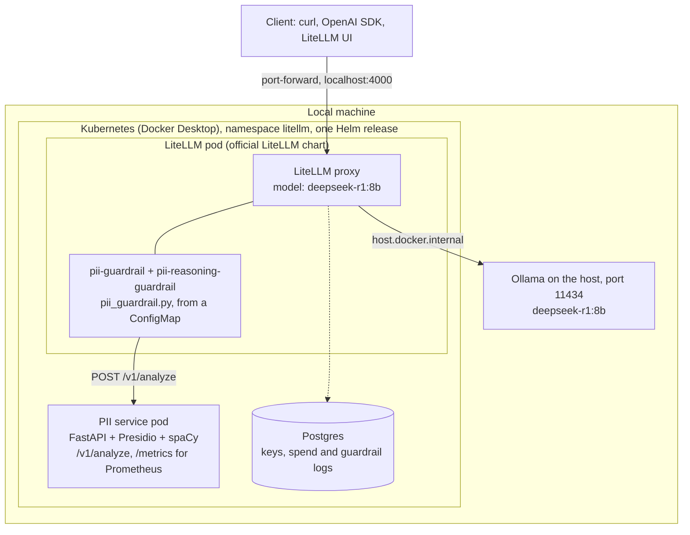
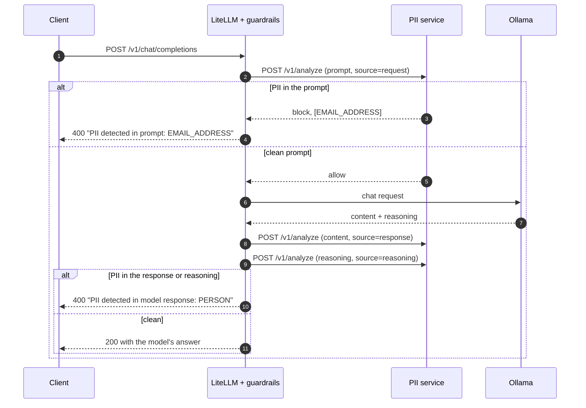

# Implementing the custom PII guardrail

This guide explains how the guardrail is built and how it plugs into LiteLLM,
following LiteLLM's [custom guardrail docs](https://docs.litellm.ai/docs/proxy/guardrails/custom_guardrail).
For setup, see the [README](../README.md).

The work is split in two:

- **The PII service** ([`pii-service/`](../pii-service)) makes the decision. It's
  a small FastAPI app built on [Microsoft Presidio](https://microsoft.github.io/presidio/),
  so it recognises every PII type Presidio does, and it exposes Prometheus metrics.
- **The LiteLLM guardrail** ([`guardrail/pii_guardrail.py`](../guardrail/pii_guardrail.py))
  sends the text of each prompt and model response to the service over HTTP, and
  blocks the call when the service says so.

Both run in Kubernetes, deployed with one Helm chart
([`charts/litellm-guardrail/`](../charts/litellm-guardrail)).

## Architecture

Everything runs locally: LiteLLM, Postgres and the PII service in Docker
Desktop's Kubernetes, and the model in Ollama on the host machine.



### Request flow



If the PII service can't be reached or returns an error, the call fails with a
500 instead of letting unchecked text through.

For streamed responses, LiteLLM holds the chunks until the whole response has
been checked (`streaming_buffer_until_moderated`), so a blocked response sends
the client only the error, never part of the PII.

## The PII service

[`pii-service/app/`](../pii-service/app) has three modules.

### `detector.py`: the decision

```python
class PIIDetector:
    def __init__(self, settings: Settings, analyzer: AnalyzerEngine | None = None): ...
    def decide(self, texts: list[str]) -> Decision: ...   # Decision(block=True, entities=["EMAIL_ADDRESS"])
```

- It uses every entity type Presidio supports for the language (19 for English:
  `EMAIL_ADDRESS`, `PERSON`, `PHONE_NUMBER`, `US_SSN`, `CREDIT_CARD`,
  `LOCATION`, `DATE_TIME`, `IP_ADDRESS`, `URL` and more), minus any listed in
  `PII_IGNORED_ENTITIES`.
- A match counts only if Presidio's confidence is at least `PII_SCORE_THRESHOLD`
  (default 0.4). Presidio scores phone numbers at 0.4, so a higher default would
  miss them, while very weak matches (0.01 to 0.05, such as any 9-digit number)
  stay below it.
- It checks each text and also all of them joined, so PII split across message
  parts (`"jane@"` + `"example.com"`) is still caught.
- The decision names the PII types, never the values.

### `main.py`: the HTTP API

| Endpoint | Purpose |
| --- | --- |
| `POST /v1/analyze` | `{"texts": [...], "source": "request"}` returns `{"block": true, "entities": ["EMAIL_ADDRESS"]}`. `source` is `request`, `response` or `reasoning`, and is used for metrics. |
| `GET /healthz` | Liveness and readiness. The service only answers once the spaCy model has loaded. |
| `GET /metrics` | Prometheus metrics. |

Analysis runs in FastAPI's thread pool (a plain `def` endpoint), so a long text
doesn't stall the server.

### `metrics.py`: Prometheus metrics

| Metric | Type | Labels |
| --- | --- | --- |
| `pii_service_requests_total` | counter | `source`, `decision` (`block` or `allow`) |
| `pii_service_entities_detected_total` | counter | `source`, `entity_type` |
| `pii_service_errors_total` | counter | `source` |
| `pii_service_analysis_duration_seconds` | histogram | `source` |

Standard `process_*` and `python_*` metrics are included. The pods carry
`prometheus.io/scrape` annotations, and the chart can create a `ServiceMonitor`
for the Prometheus Operator (`piiService.serviceMonitor.enabled`).

### Container image

[`pii-service/Dockerfile`](../pii-service/Dockerfile) installs Presidio and
spaCy's large English model (`en_core_web_lg`) and runs as a non-root user. It
also fetches the Public Suffix List, which Presidio's email and URL recognizers
need, at build time, so the service makes no network calls at runtime. The
`test` stage runs the service's tests against the real model.

## The LiteLLM guardrail

[`guardrail/pii_guardrail.py`](../guardrail/pii_guardrail.py) has four small classes:

| Class | Role |
| --- | --- |
| `PIIServiceClient` | Calls `POST /v1/analyze` with LiteLLM's shared HTTP client and returns the PII types found. Raises if the service is unreachable or errors, so the call fails closed. |
| `PIIServiceGuardrail` | Base class: creates the client from the guardrail's `api_base` and `timeout`, and raises the 400 when PII is found. |
| `PIIGuardrail` | Implements `apply_guardrail`, the single method the docs recommend. LiteLLM calls it with the prompt (`pre_call`) and the response (`post_call`), for every endpoint and provider. |
| `PIIReasoningGuardrail` | Checks `reasoning_content` on non-streamed responses. LiteLLM doesn't include reasoning in `apply_guardrail`'s input, and when a guardrail implements `apply_guardrail` LiteLLM never calls its other hooks, so reasoning needs a separate guardrail that uses the `post_call` hook. |

```python
class PIIGuardrail(PIIServiceGuardrail):
    streaming_buffer_until_moderated = True

    async def apply_guardrail(self, inputs, request_data, input_type, logging_obj=None):
        await self.block_if_pii(inputs.get("texts") or [], input_type)
        return inputs
```

Streamed reasoning is covered by the model setting
`merge_reasoning_content_in_choices: true`, which moves the reasoning into the
content, where `PIIGuardrail` checks it. Clients then see the reasoning inside
`<think>` tags in the content.

## The Helm chart

[`charts/litellm-guardrail/`](../charts/litellm-guardrail) is an umbrella chart:

- **The official LiteLLM chart** (`litellm-helm` 1.105.1) as a dependency, which
  also deploys Postgres. Its values, in [`values.yaml`](../charts/litellm-guardrail/values.yaml)
  under `litellm:`, define the model and register both guardrails:

  ```yaml
  guardrails:
    - guardrail_name: pii-guardrail
      litellm_params:
        guardrail: pii_guardrail.PIIGuardrail   # <file>.<Class>
        mode: [pre_call, post_call]
        default_on: true
        api_base: http://pii-service:8000
  ```

- **A ConfigMap with the guardrail code**, mounted into the LiteLLM pod at
  `/etc/litellm/pii_guardrail.py`. LiteLLM loads guardrail modules from the
  directory its `config.yaml` is in. The code is passed at install time with
  `--set-file guardrailCode=guardrail/pii_guardrail.py`.
- **The PII service** Deployment and Service, with its detection settings as
  values (`piiService.scoreThreshold`, `piiService.ignoredEntities`).

[`scripts/deploy.sh`](../scripts/deploy.sh) builds the PII service image, loads
it into the cluster, and installs or upgrades the release.

## Design decisions

| Decision | Why |
| --- | --- |
| The service decides, the guardrail only enforces | Detection can change (models, thresholds, entity types) without touching LiteLLM, and the service can be scaled and monitored on its own. |
| Fail closed | If the PII service is down, unchecked text could contain PII, so the call fails. |
| Raise `HTTPException(400)` to block | LiteLLM logs it as `guardrail_intervened`, a policy block. A plain `Exception` would return a 500 and be logged as `guardrail_failed_to_respond`. |
| `default_on: true` | Runs on every request, so clients can't skip it. |
| Every Presidio entity type blocks by default | This gives LiteLLM Presidio's full coverage. It's broad: names, places and dates also block, including in the model's reasoning. `piiService.ignoredEntities` narrows it without code changes. |
| Pin LiteLLM 1.105.1 | The guardrail depends on behaviour of this release: how the file is loaded, the streaming setting, and which hooks run. |

## Limitations

- With every entity type enabled, ordinary requests are sometimes blocked: model
  answers and reasoning often contain dates, names or places. Add those types to
  `piiService.ignoredEntities` if that's too strict.
- Presidio's English model is used, so PII in other languages is detected less
  reliably.
- Tool-call arguments aren't checked.
- It blocks and never masks.
