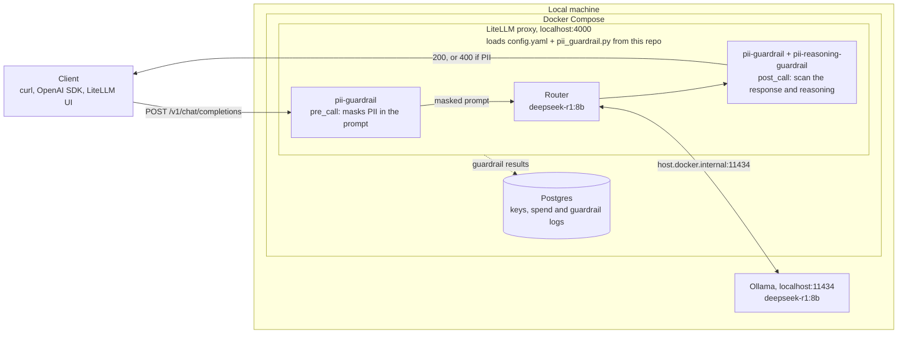
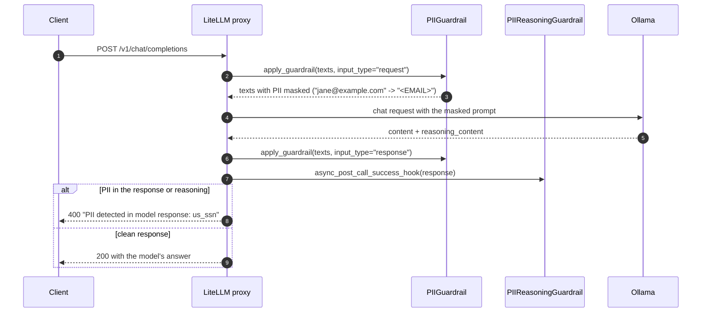

# Implementing the custom PII guardrail

This guide explains how the guardrail is built and how it plugs into LiteLLM,
following LiteLLM's [custom guardrail docs](https://docs.litellm.ai/docs/proxy/guardrails/custom_guardrail).
For setup, see the [README](../README.md).

## Architecture

Everything runs locally: the LiteLLM proxy and Postgres in Docker, and the
model in Ollama on the host machine.



### Request flow



Prompts are masked rather than blocked because chat clients resend the whole
conversation every turn. A blocked message would stay in the history and block
every later turn, until the user cleared the chat. A masked message is masked
again each turn, so the conversation carries on and the model never sees the PII.

Responses are still blocked. With the prompt masked, the model rarely has PII to
repeat, but it can still produce some, from its training data for example. And a
blocked response doesn't get stuck: the client keeps only the error, which
contains no PII.

For streamed responses, LiteLLM holds the chunks until the whole response has
been scanned (`streaming_buffer_until_moderated`), so a blocked response sends
the client only the error, never part of the PII.

## How it's built

All the code is in [`pii_guardrail.py`](../pii_guardrail.py).

### 1. A detector with one regex per PII type

`PIIDetector` knows nothing about LiteLLM, so it can be tested on its own.

```python
class PIIDetector:
    PATTERNS = {
        "email": re.compile(r"(?<![A-Za-z0-9_.%+-])[A-Za-z0-9_.%+-]+@(?:[A-Za-z0-9-]+\.)+[A-Za-z]{2,}\b"),
        "us_ssn": re.compile(r"(?<![\d-])(?!000|666|9\d\d)\d{3}-(?!00)\d{2}-(?!0000)\d{4}(?![\d-])"),
    }

    def detect(self, text: str) -> list[str]: ...
    def detect_all(self, texts: list[str]) -> list[str]: ...
    def mask(self, text: str) -> str: ...      # "jane@example.com" -> "<EMAIL>"
```

- **SSN:** the regex rejects numbers that are never issued (area `000`, `666`
  or `9xx`, group `00`, serial `0000`) and numbers that are part of a longer
  number.
- **Email:** the match starts with a lookbehind rather than `\b`. With `\b`, a
  long run like `a.a.a...` is rescanned from every position, and a 128 KB
  prompt froze the gateway for about 10 seconds. With the lookbehind, it takes
  milliseconds.
- **`detect_all`:** checks each text and also all of them joined, so PII split
  across message parts (`"jane@"` + `"example.com"`) is still caught.
- **`mask`:** replaces each piece of PII with its type, such as `<EMAIL>` or
  `<US_SSN>`.

### 2. A guardrail class that implements `apply_guardrail`

The docs recommend implementing this single method. LiteLLM extracts the text
from the request or response, for every endpoint and provider, and passes it
in `inputs["texts"]`.

```python
class PIIGuardrail(CustomGuardrail):
    detector = PIIDetector()
    streaming_buffer_until_moderated = True

    async def apply_guardrail(self, inputs, request_data, input_type, logging_obj=None):
        texts = inputs.get("texts") or []
        if not texts:
            return inputs
        if input_type == "request":
            inputs["texts"] = self._mask_prompt(texts)
        elif found := self.detector.detect_all(texts):
            raise pii_blocked_error(found, "model response")
        return inputs
```

Returning `inputs` with edited `texts` masks the call: LiteLLM writes the texts
back into the request before sending it to the model, on every endpoint
(chat completions, `/v1/messages`, the Responses API). Raising blocks the call.
PII split across message parts can't be masked in place, so that prompt is
blocked instead.

### 3. A second class for reasoning output

Reasoning models such as DeepSeek-R1 return their reasoning in a separate
`reasoning_content` field. LiteLLM doesn't include it in `inputs["texts"]`, and
when a guardrail implements `apply_guardrail`, LiteLLM never calls that
guardrail's other hooks. So reasoning needs its own guardrail, using the
`post_call` hook that receives the whole response:

```python
class PIIReasoningGuardrail(CustomGuardrail):
    @log_guardrail_information
    async def async_post_call_success_hook(self, data, user_api_key_dict, response):
        ...  # scan choice.message.reasoning_content
```

This hook only runs on non-streamed responses. For streamed ones, the model
setting `merge_reasoning_content_in_choices: true` moves the reasoning into the
content, where `PIIGuardrail` scans it.

### 4. Register the guardrails in `config.yaml`

```yaml
guardrails:
  - guardrail_name: pii-guardrail
    litellm_params:
      guardrail: pii_guardrail.PIIGuardrail   # <file>.<Class>
      mode: [pre_call, post_call]
      default_on: true
  - guardrail_name: pii-reasoning-guardrail
    litellm_params:
      guardrail: pii_guardrail.PIIReasoningGuardrail
      mode: post_call
      default_on: true
```

LiteLLM loads the `.py` file from the directory `config.yaml` is in.
`default_on: true` runs the guardrails on every request, so clients can't skip
them.

### 5. Mount the code and start the proxy

[`docker-compose.yml`](../docker-compose.yml) mounts the repo at `/app/custom`
and starts LiteLLM with `--config /app/custom/config.yaml`. The whole directory
is mounted rather than single files: on Docker Desktop, editing a single-file
mount can make the file vanish from the running container.

## Design decisions

| Decision | Why |
| --- | --- |
| Raise `HTTPException(400)`, not `Exception` | The docs' plain `Exception` returns a 500 and is logged as `guardrail_failed_to_respond`, as if the guardrail had broken. A 400 is logged as `guardrail_intervened`: a policy block. |
| Mask prompts, block responses | Masking prompts keeps chats usable (see Request flow). Responses are blocked rather than masked because masking a streamed response only works on `/v1/chat/completions`: on other routes LiteLLM drops a guardrail's rewrite and would send the original text. |
| Name the PII types, never the values | Masked prompts, blocked responses and logs don't repeat the PII. |
| `streaming_buffer_until_moderated = True` | Without it, `post_call` on a streamed response only runs after the content has reached the client. |
| Pin `litellm:v1.105.1` | The guardrails depend on behaviour of this release: how the file is loaded, the streaming setting, and which hooks run. |

## Limitations

- Regex catches PII in standard formats and accidental disclosure. It won't
  stop someone deliberately avoiding it (`jane at example dot com`,
  `123 45 6789`).
- Only message text and reasoning are scanned, not tool-call arguments.
- The model sees placeholders such as `<EMAIL>`, so it can't use the masked
  details, for example to write a reply addressed to that email.
